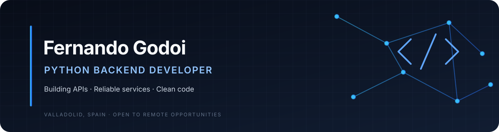

 

## About

I'm a software developer focused on **Python backend development** and building practical, maintainable applications. I enjoy working on API design, data validation, database integration, authentication concepts and automated testing.

Currently based in **Valladolid, Spain**, and interested in **remote opportunities across Spain and Europe**.

- Backend development with Python and FastAPI
- REST API design, validation and documentation
- Relational databases and schema migrations
- Automated testing and code quality
- Learning through practical, documented projects

## Technical toolkit

## Selected projects

| Project | What it demonstrates |
|---|---|
| [FastAPI Task Manager](https://github.com/fergodoii94/fastapi-task-manager) | Multi-user FastAPI REST API, JWT/Argon2 authentication, per-user task isolation, SQLAlchemy 2.0, Alembic migrations, Docker and automated tests. |
| [E-commerce Backend API](https://github.com/fergodoii94/ecommerce-backend-api) | Backend prototype covering product/order flows, server-side totals, stock checks and API tests. |
| [JWT Auth System](https://github.com/fergodoii94/jwt-auth-system) | A focused example of JWT creation and token validation. |
| [WebSocket Echo Server](https://github.com/fergodoii94/websocket-chat-app) | An asynchronous WebSocket echo-server project with message-size limits and tests. |

> These are portfolio and learning projects. Their READMEs describe the implemented scope and current limitations; they should not be assumed to be production services.

## What I'm focusing on

- Writing clear, typed and maintainable Python
- Building and testing REST APIs with FastAPI
- Designing reliable database models and migrations
- Applying authentication and security fundamentals
- Improving CI workflows and reproducible development environments

## Let's connect

I'm open to discussing Python backend projects, collaborating with developers and exploring remote junior backend opportunities in Spain and Europe.

**GitHub:** [@fergodoii94](https://github.com/fergodoii94)

---

Built with care · Python Backend · Valladolid, Spain

